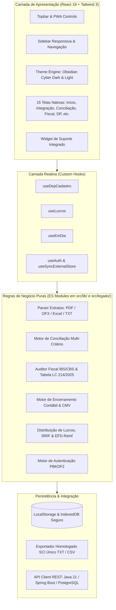

# ⚡ MakerPixel Techsystem — Gestão Financeira, Inteligência Contábil & Tributária

<div align="center">

[](https://mauricio-g-oliveira.github.io/makerpixel-gestao/)
[](https://react.dev)
[](https://vitejs.dev)
[](https://tailwindcss.com)
[](https://mauricio-g-oliveira.github.io/makerpixel-gestao/)
[-10B981?style=for-the-badge&logo=nodedotjs&logoColor=white)](https://github.com/Mauricio-G-Oliveira/makerpixel-gestao)
[](LICENSE)

<br />

**Plataforma corporativa SaaS para Gestão Contábil, Financeira e Fiscal. Reúne integração bancária multi-formato (OFX/PDF/Excel), conciliação com ERPs contábeis (SCI Único), apuração tributária (ICMS, ISS, Auditor IBS/CBS Reforma Tributária LC 214/2025), departamento societário/cadastro de empresas, distribuição de lucros com IRRF/EFD-Reinf e encerramento de exercício contábil.**

[Acessar Demonstração Online](https://mauricio-g-oliveira.github.io/makerpixel-gestao/) • [Modelo de Branches](docs/GIT.md) • [Repositório GitHub](https://github.com/Mauricio-G-Oliveira/makerpixel-gestao)

</div>

---

## 💎 Destaques da Arquitetura & Portfólio

Projetado sob padrões de engenharia sênior para atender operações contábeis de alta exigência, segurança de dados e alta performance:

- 🛡️ **Privacidade & Segurança (Client-Side First)**: Processamento seguro de extratos bancários confidenciais (PDF, OFX, CSV, Excel) e notas fiscais XML diretamente no navegador. Suporte total à LGPD sem expor dados desnecessários a servidores externos.
- ⚡ **Stack Moderna & Reativa**: Construído com **React 18**, **React Router 6 (HashRouter)**, **Tailwind CSS 3** e **Vite 5**. Arquitetura desacoplada onde regras de negócio puras (`src/lib/*.mjs`) residem fora do ciclo de vida dos componentes React, garantindo **testabilidade de 100%** via `node:test`.
- 📱 **PWA Instalável Desktop & Mobile**: Suporte a instalação nativa com Service Worker inteligente (`self.skipWaiting()`), cache de assets estáticos e funcionamento offline.
- 🎨 **Identidade Visual Obsidian Cyber Dark**: Design system profissional escuro com contrastes em ciano neon (`#00E5FF`), modo claro com conformidade WCAG AAA, navegação expansível e responsiva.
- 🏛️ **Auditor da Reforma Tributária (LC 214/2025 & LC 227/2026)**: Auditoria fiscal de XMLs de NF-e e NFS-e, validando CSTs, cClassTrib, bases reduzidas e 445 NCMs tabelados da nova legislação fiscal brasileira.
- 🔌 **Preparado para Backend Java Spring Boot + PostgreSQL**: Camada de serviço com desacoplamento arquitetural e adaptadores prontos para chavear entre persistência local (IndexedDB / localStorage) e REST API corporativa com JWT.

---

## 🏛️ Arquitetura do Sistema



---

## 📦 Módulos Funcionais

### 1. 🔄 Integração Contábil & ERP (`/integracao`)
- **Parsers de Extratos Bancários**: Leitura automática de OFX, PDF (Itaú, Santander, Sicoob, Sicredi, Caixa, BB, Nubank, Inter, C6, Banrisul, etc.) e Excel.
- **Regras Contábeis**: Classificação automática por histórico, favorecido e conta contábil.
- **Exportação Homologada**: Gera arquivo posicional para ERPs contábeis (SCI Único, etc.) por matriz e filiais, além de relatórios de pendências e backup JSON.

### 2. ⚖️ Conciliação Bancária (`/conciliacao`)
- Cruzamento automatizado de **Extrato × Planilha / Balancete / XMLs** com tolerância temporal de compensação bancária e agrupamentos manuais com justificativa de divergência.

### 3. 🧾 Inteligência Fiscal & Reforma Tributária (`/icms`, `/iss`, `/ibs-cbs`)
- **Apuração de ICMS**: Regras de crédito/débito com ajustes específicos por empresa.
- **ISS Municipal**: Importação de XMLs de NFS-e de portais tributários municipais.
- **Auditor IBS/CBS (LC 214/2025 & LC 227/2026)**: Leitura de XMLs de NF-e/NFS-e com validação de CST, cClassTrib, alíquotas estaduais/municipais e comparação com banco de 445 NCMs da nova reforma.

### 4. 🗂️ Departamento Societário & Cadastro (`/departamento-cadastro/...`)
- **Consulta & Ficha Cadastral**: Busca rápida por CNPJ com consolidação de matriz, filiais, sócios, faturamento de 12 meses e certidões.
- **Grade de Alvarás**: Monitoramento de alvarás de funcionamento, sanitário e corpo de bombeiros com indicadores visuais de situação.
- **Certidões & Certificados Digitais A1/A3**: Alertas preditivos de vencimento, leitor de metadados em PDF e gerador de notificações para clientes via WhatsApp/e-mail.

### 5. 📊 Fechamento, Encerramento & Distribuição de Lucros (`/fechamento`, `/encerramento`, `/lucros`, `/reinf`)
- **Encerramento de Exercício**: Inventário de estoques, compras do período, cálculo de CMV e apuração de lucro bruto consolidado.
- **Distribuição de Lucros & EFD-Reinf**: Cálculo de retenção de IRRF (10% acima de R$ 50 mil mensais), prazos de DARF e exportação pronta para a escrituração do EFD-Reinf.

### 6. 📅 Compliance "Em Dia" & Horas (`/em-dia`, `/horas`)
- Matriz de obrigações fiscais/contábeis por setor, responsável e competência com workflow de passagem de bastão e apontamento de horas da equipe.

---

## 🛠️ Stack Tecnológica

| Camada | Tecnologia | Descrição |
|---|---|---|
| **Frontend Framework** | React 18.3 | Arquitetura SPA moderna com renderização eficiente |
| **Roteamento** | React Router 6.26 (HashRouter) | Compatível com GitHub Pages e execução em subdiretórios |
| **Estilização & UI** | Tailwind CSS 3.4 + Design Tokens | Identidade Obsidian Cyber Dark (`#060B13`, `#0A1220`, `#00E5FF`) |
| **Build & Tooling** | Vite 5.4 | Bundler de altíssima velocidade e HMR |
| **Processamento de Arquivos** | SheetJS, ExcelJS, PDF.js, JSZip | Parsers client-side carregados sob demanda (lazy loading) |
| **PWA & Offline** | Service Worker customizado (`pwa/`) | Instalável no desktop/mobile, ativação com `self.skipWaiting()` |
| **Testes Automatizados** | Node.js Test Runner (`node:test`) | Mais de 340 testes unitários e de integração das regras de negócio |
| **CI/CD** | GitHub Actions | Pipeline automatizada de testes, build e deploy contínuo |
| **Backend (Roadmap)** | Java 21 + Spring Boot 3 + PostgreSQL | Persistência corporativa centralizada para múltiplos usuários |

---

## 🌿 Branches & Governança (Git Flow)

Adotamos o fluxo de governança profissional baseado em **Git Flow**:

```
main        ●───────────────────────●───────────────────────▶  Produção (Deploy no GitHub Pages)
             \                     ↗ \                     ↗
develop       ●───────●───────────●   ●───────●───────────●   Homologação & Staging
               \     ↗ \         ↗     \     ↗ \         ↗
feat/*          ●───●   ●───────●       ●───●   ●───────●     Features e Correções (via PRs)
```

- **`main`**: Código em produção, estável e deployado automaticamente.
- **`develop`**: Linha de homologação para validação conjunta de novos módulos.
- **`feat/*`**, **`fix/*`**: Branches efêmeras criadas a partir de `develop` e mescladas exclusivamente via Pull Request com suíte de testes verde.

Consulte o guia completo em [`docs/GIT.md`](docs/GIT.md).

---

## 🚀 Como Executar Localmente

### Pré-requisitos
- **Node.js 20+** (recomendado Node 22 ou 24)
- **npm 9+**

### Instalação e Desenvolvimento
```bash
# Clonar o repositório
git clone https://github.com/Mauricio-G-Oliveira/makerpixel-gestao.git
cd makerpixel-gestao

# Instalar dependências
npm install

# Iniciar servidor de desenvolvimento
npm run dev
# Acesse em http://localhost:5173
```

### Comandos de Teste e Build
```bash
# Executar a suíte de testes automatizados
npm test

# Gerar o build otimizado para produção (dist/)
npm run build

# Pré-visualizar o build de produção localmente
npm run preview
```

---

## 👤 Autor & Contato

**Maurício Oliveira**  
*Software Engineer / Full Stack Developer*  
- **LinkedIn**: [linkedin.com/in/mauriciogoulartdev](https://www.linkedin.com/in/mauriciogoulartdev)  
- **GitHub**: [github.com/Mauricio-G-Oliveira](https://github.com/Mauricio-G-Oliveira)  
- **E-mail**: [mauriciogoulart.deoliveira37@gmail.com](mailto:mauriciogoulart.deoliveira37@gmail.com)

---

## 📄 Licença & Propriedade

Copyright © 2026 **MakerPixel Techsystem**. Todos os direitos reservados.  
Desenvolvido para portfólio público de engenharia de software e comercialização SaaS.
