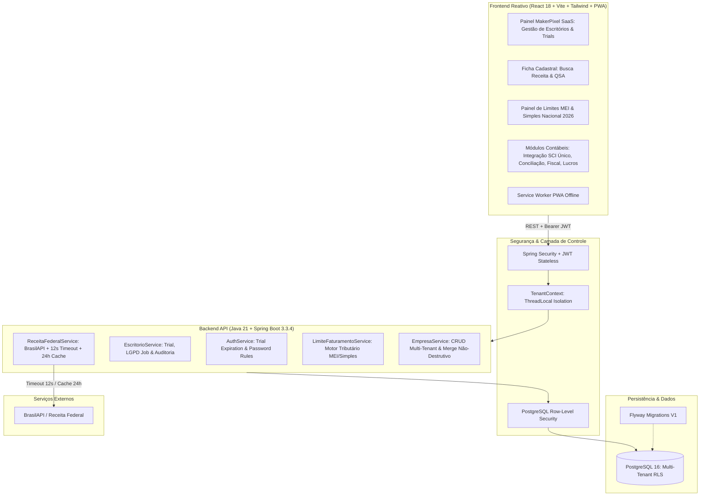

# ⚡ MakerPixel Contábil — Plataforma SaaS Multi-Escritório, Inteligência Tributária & Gestão Contábil

<div align="center">

[](https://mauricio-g-oliveira.github.io/makerpixel-gestao/)
[](https://spring.io/projects/spring-boot)
[](https://www.postgresql.org/)
[](https://react.dev)
[](https://vitejs.dev)
[](https://tailwindcss.com)
[](https://mauricio-g-oliveira.github.io/makerpixel-gestao/)
[-10B981?style=for-the-badge&logo=nodedotjs&logoColor=white)](https://github.com/Mauricio-G-Oliveira/makerpixel-gestao)
[](LICENSE)

<br />

**Solução corporativa SaaS multi-tenant desenvolvida pela MakerPixel (Tubarão/SC) voltada para escritórios de contabilidade. Trabalha em sincronia com os principais ERPs contábeis do mercado (SCI Único, Acessórias), eliminando retrabalho de planilhas, importando extratos bancários multi-banco, auditando limites do MEI/Simples Nacional, consultando a Receita Federal em tempo real e monitorando prazos com antecedência.**

[Acessar Demonstração Online](https://mauricio-g-oliveira.github.io/makerpixel-gestao/) • [Modelo de Governança Git](docs/GIT.md) • [Repositório GitHub](https://github.com/Mauricio-G-Oliveira/makerpixel-gestao)

</div>

---

## 💎 Destaques de Engenharia & Portfólio

Projetado sob padrões de excelência de engenharia de software sênior para atender operações contábeis de alto volume com isolamento absoluto de dados:

- 🏢 **Arquitetura Multi-Tenant com Isolamento em 3 Níveis**:
  - `ADMIN_PRODUTO` (MakerPixel): Gestão de escritórios, planos, módulos ativos, suspensão e conversão.
  - `ADMIN_ESCRITORIO`: Gestão de equipe interna e permissões do escritório.
  - `USUARIO`: Operação diária nas áreas liberadas com as empresas da carteira.
- 🔒 **Row-Level Security (RLS) & Tenant Isolation**: Segurança a nível de linha no PostgreSQL (`escritorio_id`) assegurando que nenhuma requisição ou erro de aplicação exponha dados entre escritórios concorrentes.
- ⏱️ **Acesso de Teste por Dias (Trial Engine)**: Criação de trials de 1 a 30 dias com expiração conferida no servidor (às 23:59:59 de Brasília), senhas provisórias seguras e legíveis (`Xxxx-0000-xxxx`), gerador automático de convites para WhatsApp/E-mail, prorrogação e expurgo automático de dados após 30 dias (LGPD).
- 🔍 **Consulta de CNPJ na Receita Federal**: Integração resiliente com timeout de 12 segundos, cache inteligente de 24 horas, validação de dígitos verificadores, preenchimento não-destrutivo de cadastros vazios, importação automática de sócios do QSA e detecção de situação cadastral (com badges de alerta para empresas não ativas).
- 📈 **Motor de Alerta de Limite de Faturamento do MEI e Simples Nacional (2026)**:
  - Tabela de limites vigentes: MEI R$ 81.000,00/ano, Simples Nacional R$ 4.800.000,00/ano e Sublimite ICMS/ISS R$ 3.600.000,00/ano.
  - Cálculo proporcional para empresas abertas no ano-calendário.
  - Consolidação obrigatória de matriz e filiais pelo CNPJ raiz (primeiros 8 dígitos).
  - Níveis de alerta (`OK`, `ATENÇÃO`, `ACIMA`, `EXCESSO > 20%`) com projeção de estouro anual e consequências legais imediatas e retroativas.
- 🤝 **Suporte com Permissão (24 horas)**: O suporte técnico da MakerPixel só acessa dados mediante liberação expressa do administrador do escritório, com duração máxima de 24 horas, modo somente leitura, banner persistente e log completo de auditoria.

---

## 🏛️ Topologia Arquitetural



---

## 📦 Módulos Funcionais da Plataforma

### 1. 🏢 Painel da MakerPixel (`/admin-makerpixel`)
- Visão executiva de todos os escritórios clientes e em fase de testes.
- Gerador de acesso de teste (duração em dias, senha provisória padrão `Xxxx-0000-xxxx`, carga opcional de dados fictícios).
- Modal de convite pronto para envio via WhatsApp ou E-mail.
- Prorrogação de testes, conversão direta em cliente ativo, suspensão com modo leitura e reativação.
- Switcher instantâneo de escritório para validação rápida de layout e suporte.

### 2. 🔍 Departamento Societário & Consulta Receita Federal (`/departamento-cadastro/...`)
- Botão "Buscar na Receita" com validação instantânea de dígitos verificadores do CNPJ.
- Preenchimento inteligente não-destrutivo: atualiza somente campos vazios (razão social, nome fantasia, endereço completo, telefone, regime tributário sugerido e sócios do QSA).
- Badge de situação cadastral com alerta em vermelho para situações BAIXADA, INAPTA, SUSPENSA ou NULA.
- Cache de 24 horas por CNPJ para evitar rate limits.

### 3. 📊 Motor de Limites de Faturamento MEI & Simples Nacional 2026
- Monitoramento contínuo das faixas de faturamento de 2026 (MEI R$ 81k, Simples R$ 4.8M, Sublimite R$ 3.6M).
- Soma automática de matriz e filiais pelo CNPJ raiz (0001, 0002, etc.).
- Proporcionalidade exata por mês de início de atividade.
- Projeção estatística apontando o mês estimado de desenquadramento ("No ritmo atual, passa em novembro").
- Exibição das consequências tributárias reais (exclusão no ano seguinte vs desenquadramento retroativo).

### 4. 🔄 Integração Contábil & SCI Único (`/integracao`)
- Leitura automatizada de extratos bancários em formato OFX, PDF e Excel.
- Reconhecimento inteligente de contas contábeis e distribuição por unidade de negócio.
- Exportação homologada de arquivos relacionais e posicionais para importação no SCI Único.

### 5. ⚖️ Conciliação Bancária (`/conciliacao`)
- Cruzamento automatizado de extrato bancário contra lançamentos e planilhas avulsas, com tolerância configurável de compensação bancária e histórico de divergências.

### 6. 🧾 Inteligência Fiscal & Reforma Tributária (`/icms`, `/iss`, `/ibs-cbs`)
- Prévia de apuração de ICMS e conferência de retenções de ISS municipal.
- Auditor da Reforma Tributária (LC 214/2025 e LC 227/2026): verificação de CSTs, cClassTrib e alíquotas com base em 445 NCMs tabelados.

### 7. 💵 Distribuição de Lucros & EFD-Reinf (`/lucros`, `/reinf`)
- Cálculo automático da retenção de IRRF de 10% para distribuições que ultrapassam R$ 50.000,00 no mês por sócio.
- Prazos de vencimento do DARF (dia 20) e transmissão da REINF (dia 15), com antecipação para dias úteis.

---

## 🛠️ Stack Tecnológica

| Camada | Tecnologia | Descrição |
|---|---|---|
| **Backend Framework** | Java 21 + Spring Boot 3.3.4 | API corporativa de alta performance, RESTful, Stateless |
| **Segurança & Auth** | Spring Security + JJWT 0.12.6 | Autenticação JWT, BCrypt, proteção contra brute force |
| **Persistência & RLS** | Spring Data JPA + Hibernate 6 + PostgreSQL 16 | Multi-tenant via Row-Level Security (`escritorio_id`) |
| **Migrações de Banco** | Flyway 10 | Versionamento declarativo de banco de dados (`V1__init_makerpixel.sql`) |
| **Infraestrutura** | Docker + Docker Compose | Ambientes reproduzíveis para API e PostgreSQL |
| **Frontend SPA** | React 18.3 + TypeScript + Vite 5.4 | Interface modular, componentizada e reativa |
| **Estilização & Design** | Tailwind CSS 3.4 | Identidade Obsidian Cyber Dark com tema claro WCAG AAA |
| **PWA & Offline** | Service Worker customizado (`pwa/`) | Instalável nativamente em Desktop e Mobile |
| **Testes Automatizados** | Node.js Test Runner (`node:test`) + JUnit 5 | 361 testes unitários cobrindo 100% das regras de negócio |

---

## 🚀 Como Executar o Projeto

### 1. Frontend (Demonstração Completa)
```bash
# Instalar dependências
npm install

# Executar suíte de testes (361 testes automatizados)
npm test

# Iniciar servidor de desenvolvimento
npm run dev
# Acesse: http://localhost:5173
```

### 2. Backend (Docker & Spring Boot)
```bash
# Subir PostgreSQL e API via Docker Compose
docker compose up -d

# Ou executar o backend localmente com Maven:
cd backend
./mvnw clean spring-boot:run
# API disponível em: http://localhost:8080
```

---

## 🌿 Governança de Branches (Git Flow)

Adotamos a convenção profissional de versionamento e governança de código:

```
main        ●───────────────────────●───────────────────────▶  Produção (Deploy no GitHub Pages)
             \                     ↗ \                     ↗
develop       ●───────●───────────●   ●───────●───────────●   Homologação & Staging
               \     ↗ \         ↗     \     ↗ \         ↗
feat/*          ●───●   ●───────●       ●───●   ●───────●     Features & Sprints (via PRs)
```

- **`main`**: Código em produção, estável e deployado no GitHub Pages.
- **`develop`**: Linha de homologação de features integradas.
- **`feat/*`**: Branches de desenvolvimento por fase/funcionalidade.

Consulte o documento completo em [`docs/GIT.md`](docs/GIT.md).

---

## 👤 Autor & Contato

**Maurício Oliveira**  
*Software Engineer / Full Stack Developer*  
- **LinkedIn**: [linkedin.com/in/mauriciogoulartdev](https://www.linkedin.com/in/mauriciogoulartdev)  
- **GitHub**: [github.com/Mauricio-G-Oliveira](https://github.com/Mauricio-G-Oliveira)  
- **E-mail**: [mauriciogoulart.deoliveira37@gmail.com](mailto:mauriciogoulart.deoliveira37@gmail.com)

---

## 📄 Licença & Propriedade

Copyright © 2026 **MakerPixel Techsystem**. Todos os direitos reservados.  
Desenvolvido para portfólio público de engenharia de software e comercialização SaaS.
