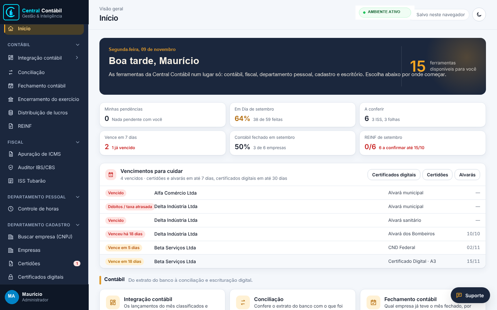
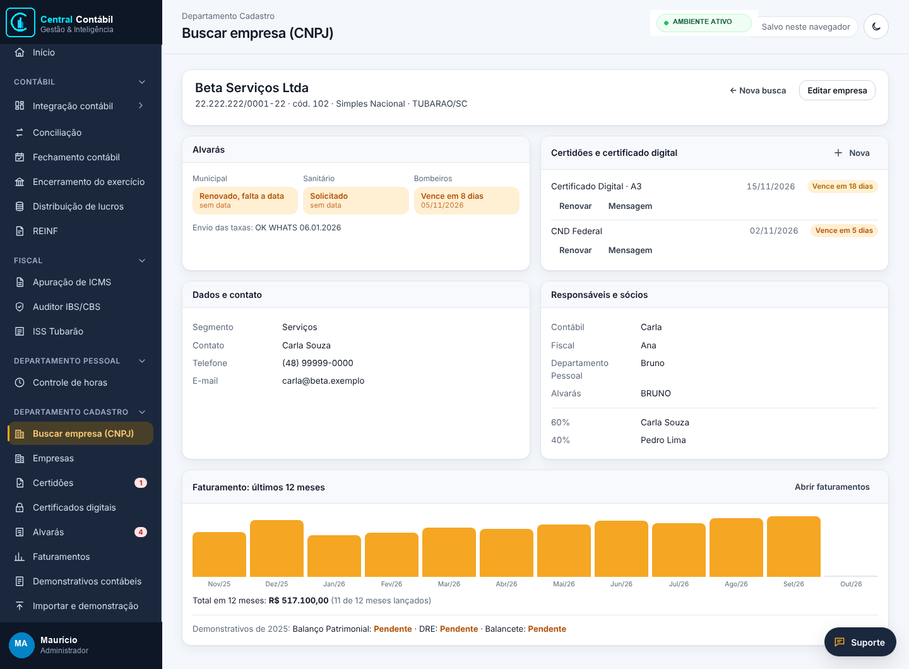
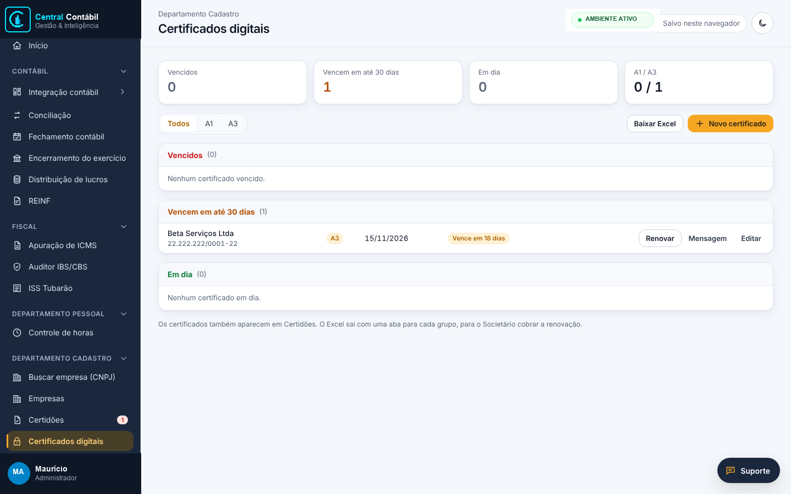
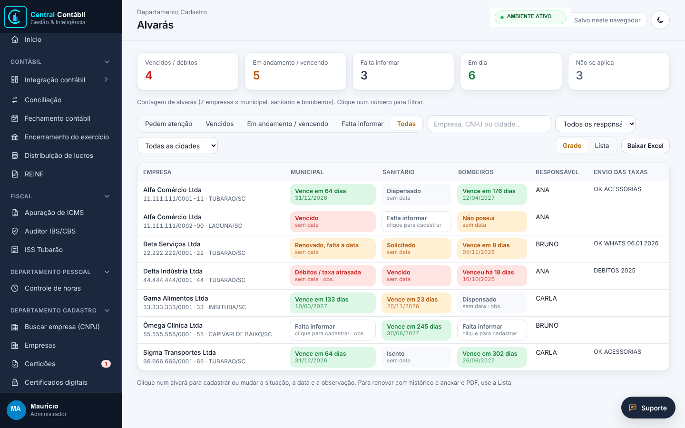
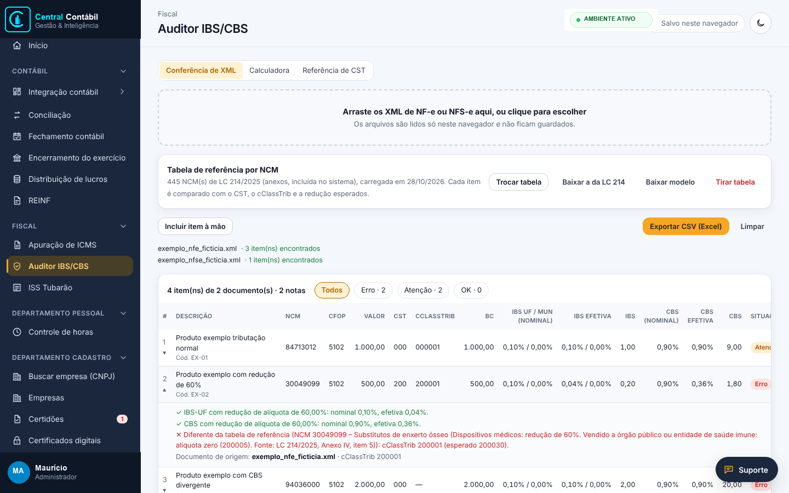
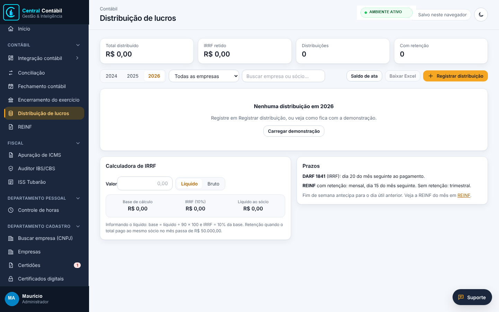
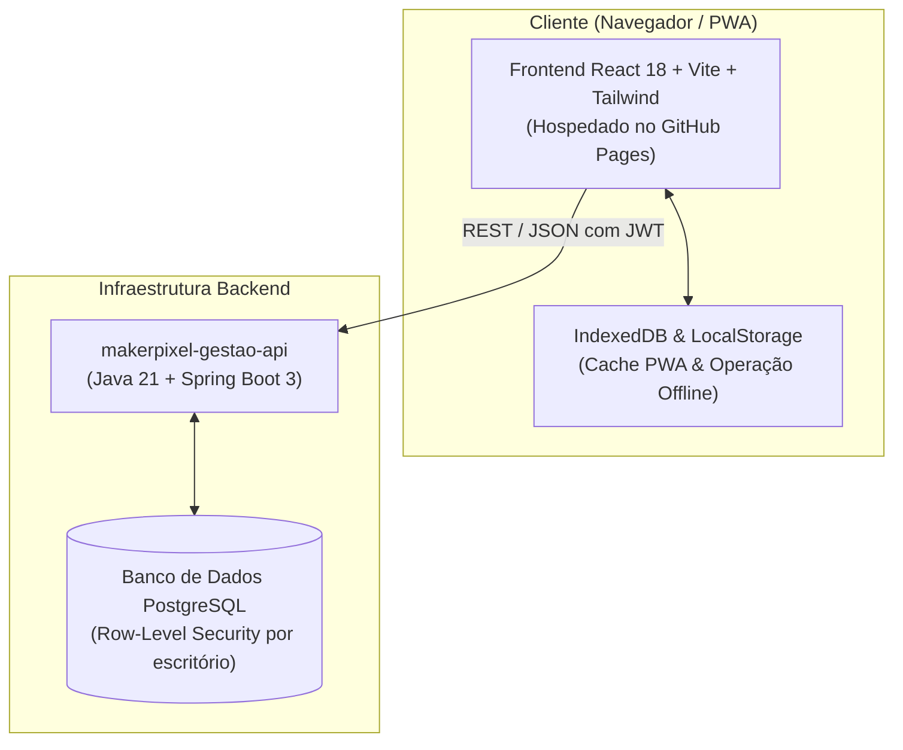

# MakerPixel Gestão Contábil

[](https://mauricio-g-oliveira.github.io/makerpixel-gestao/)
[](https://github.com/Mauricio-G-Oliveira/makerpixel-gestao-api)
[-10b981?style=flat-square&logo=nodedotjs)](https://github.com/Mauricio-G-Oliveira/makerpixel-gestao)
[](https://mauricio-g-oliveira.github.io/makerpixel-gestao/)

> Sistema de apoio operacional e financeiro para escritórios de contabilidade, integrando conciliação bancária inteligente, controle de vencimentos e inteligência cadastral e fiscal.

---

## 1. O Problema

Escritórios de contabilidade lidam com um volume elevado de rotinas manuais e fragmentadas:
- Planilhas de movimento financeiro enviadas por clientes em dezenas de formatos diferentes.
- Vencimentos de certidões negativas, alvarás municipais/sanitários e certificados digitais dispersos em pastas e e-mails.
- Retrabalho frequente na conferência bancária (tarifas repetitivas, pagamentos em lote e lançamentos com divergência de datas).
- Dificuldade na distribuição da carteira de clientes entre os colaboradores por departamento (Cadastro, Fiscal, Contábil e Pessoal).

Este sistema atua ao lado das ferramentas contábeis do escritório, eliminando digitação desnecessária, padronizando a entrada de dados e avisando sobre prazos com antecedência.

---

## 2. O que o Sistema Faz

### Departamento Cadastro
- **Divisão clara de documentos:** Três abas dedicadas — *Alvarás*, *Certificados Digitais* (A1 e A3 com alertas de até 30 dias) e *Certidões*. Certificados não se misturam com certidões e contam com controle específico.
- **Busca unificada em Empresas:** Busca com resposta instantânea e ordenação ponderada por relevância (`notaDaBusca`: CNPJ exato = 100, código = 90, parte do CNPJ = 80, início do nome = 60, meio do nome = 40, fantasia = 35, cidade = 20). Tecla Enter abre a ficha da primeira empresa e o endereço mantém o filtro em `?q=`.
- **Leitor de PDFs integrado:** Na aba de certidões e alvarás, o botão "Ler PDFs" extrai tipo, CNPJ, emissão e vencimento direto dos arquivos. A prévia identifica a ação adequada (`destinoDoPdf`): cadastra novo, renova atualizando histórico, anexa se mesma data, ou recusa se anterior.
- **Carteira por responsável e setor:** Importação de planilha de obrigações com vínculo por e-mail. Exibição das empresas sob cuidado de cada colaborador, filtro automático por setor cadastrado e suporte a exceções manuais (cobertura de férias).
- **Controle de horas:** Importação de folhas de presença com identificação automática do funcionário (`nomeDaFolha` priorizando B3, intervalo C3:J3, cabeçalho A3 ou nome da aba).

### Contábil
- **Faturamentos e Demonstrativos:** Acesso restrito aos colaboradores da área contábil, com acompanhamento de limites anuais do Simples Nacional e MEI (com projeção e alertas para empresas no ano de abertura).
- **Importador de planilhas com modelos configuráveis:** Permite configurar uma vez o layout do cliente (aba, linha inicial e mapeamento de colunas de data, valor único ou entrada/saída, histórico, conta, unidade, categoria e fornecedor/cliente).
- **Destrinchamento automático:** Separa a movimentação por conta bancária e por unidade/centro de custo.
- **Classificação inteligente por regras:** Sugere categorias a partir de termos no histórico (ex.: `TARIFA` → Tarifas Bancárias, `ENERGIA` → Energia Elétrica) para aprovação em lote, além de apontar os lançamentos sem classificação.
- **Exportação customizável:** Gera arquivos em layouts parametrizáveis (ordem de colunas, delimitador ponto-e-vírgula ou vírgula, formatação de datas e valores).

### Conciliação Bancária
- **Persistência com trava de versão:** Suporte a salvamento com concorrência otimista (resposta 409 caso outro usuário tenha salvo o mesmo período com horário e nome do autor).
- **Perfis de conciliação por cliente:** Configuração de tolerância em dias, palavras-chave para conferência automática (IOF, tarifas, rendimentos) e junção de pagamentos em lote (vários lançamentos somados que fecham com um único débito no extrato).
- **Integração com o importador:** Os lançamentos destrinchados da planilha do cliente podem ser enviados diretamente para a conciliação como dados de sistema.

### Fiscal & Encerramento
- **Auditor IBS/CBS:** Conferência de alíquotas e tributação com base na LC 214/2025.
- **Conferência de retenções:** Verificação de ISS retido na fonte e apuração prévia de ICMS.
- **Distribuição de lucros:** Validação de limites com retenção de IRRF de 10% sobre parcelas acima de R$ 50 mil por mês/sócio, cálculo de saldo de ata e datas de vencimento do DARF e REINF.

---

## 3. Demonstração Visual

| Tela Inicial | Ficha da Empresa |
| :---: | :---: |
|  |  |

| Certificados Digitais | Alvarás e Vencimentos |
| :---: | :---: |
|  |  |

| Auditor Fiscal IBS/CBS | Distribuição de Lucros |
| :---: | :---: |
|  |  |

---

## 4. Arquitetura



O backend da aplicação é mantido em repositório dedicado com pipeline independente:
🔗 **[makerpixel-gestao-api (Repositório do Backend Java/Spring)](https://github.com/Mauricio-G-Oliveira/makerpixel-gestao-api)**

---

## 5. Decisões Técnicas

- **Dados locais e sincronização transparente:** O frontend utiliza IndexedDB e LocalStorage para armazenamento no navegador, permitindo uso offline (PWA) e transição para o backend por meio do serviço de conciliação e login com token JWT.
- **Processamento de arquivos no cliente:** A leitura de extratos (OFX, PDF, CSV), planilhas Excel (`.xlsx`, `.xlsm`) e certificados é realizada diretamente no navegador via FileReader e Web Workers. Nenhum arquivo com dados sensíveis de clientes é armazenado sem necessidade.
- **Configuração no lugar de código específico:** Regras que variam por cliente (tolerâncias bancárias, termos de histórico, modelos de colunas de planilha) são salvas como perfis e modelos dinâmicos no banco/armazenamento, evitando regras codificadas de forma fixa no sistema.
- **Isolamento de regras de negócio:** Todas as regras de cálculo tributário, ordenação ponderada de busca, destrinchamento de planilhas e concorrência são desenvolvidas como módulos puros em JavaScript ES Modules, testados de ponta a ponta com o executor nativo `node:test` sem dependência de emulação de navegador.

---

## 6. Como Rodar

### Pré-requisitos
- Node.js 20 ou superior (recomendado Node 22)
- Git

### Frontend (`makerpixel-techsystem`)
```bash
# Clonar o repositório
git clone https://github.com/Mauricio-G-Oliveira/makerpixel-gestao.git
cd makerpixel-gestao

# Instalar dependências
npm install

# Rodar a suíte completa de testes unitários (382 testes)
npm test

# Iniciar servidor de desenvolvimento local
npm run dev

# Gerar build de produção
npm run build
```

### Backend (`makerpixel-gestao-api`)
```bash
# Em pasta separada
git clone https://github.com/Mauricio-G-Oliveira/makerpixel-gestao-api.git
cd makerpixel-gestao-api

# Subir banco PostgreSQL via Docker Compose
docker compose up -d

# Rodar os testes automatizados da API
./mvnw test

# Iniciar a API Spring Boot
./mvnw spring-boot:run
```

---

## 7. Exemplos de Modelos

Na pasta [`docs/exemplos`](docs/exemplos) estão disponíveis arquivos fictícios de demonstração:
- `modelo-exemplo.json`: Modelo de importação configurável com mapeamento de colunas e regras de histórico.
- `planilha-movimento-exemplo.csv`: Planilha de exemplo contendo movimentações de múltiplas contas, unidades e naturezas para teste de destrinchamento.

---

## 8. Autor e Contato

Desenvolvido por **Mauricio Gonçalves de Oliveira**  
- **GitHub:** [@Mauricio-G-Oliveira](https://github.com/Mauricio-G-Oliveira)  
- **Demonstração:** [https://mauricio-g-oliveira.github.io/makerpixel-gestao/](https://mauricio-g-oliveira.github.io/makerpixel-gestao/)
