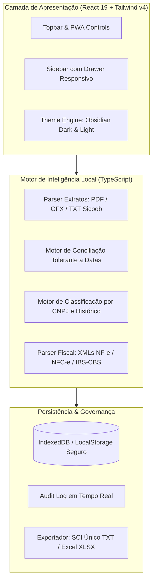

# MakerPixel Techsystem — Gestão Financeira, Inteligência Fiscal & PWA

<div align="center">

[](https://mauricio-g-oliveira.github.io/makerpixel-gestao/)
[](https://react.dev/)
[](https://www.typescriptlang.org/)
[](https://tailwindcss.com/)
[-10B981?style=for-the-badge&logo=vitest&logoColor=white)](file:///Users/mauricio/Desktop/gestao%20financeira/makerpixel-techsystem)
[](file:///Users/mauricio/Desktop/gestao%20financeira/makerpixel-techsystem)
[](LICENSE)

<br />

**Plataforma corporativa de Gestão Financeira, Conciliação Bancária Multi-Extrato, Inteligência Tributária (ICMS + Reforma Tributária LC 214/2025) e Integração Oficial com o ERP Contábil SCI Único.**

[Acessar Demonstração Online](https://mauricio-g-oliveira.github.io/makerpixel-gestao/) • [Modelo de Branches](CONTRIBUTING.md) • [Changelog](CHANGELOG.md)

</div>

---

## 💎 Destaques do Projeto & Portfólio

Este projeto foi desenhado para atender requisitos reais de escritórios contábeis e médias empresas, unindo **rigor matemático contábil**, **arquitetura moderna de frontend** e **máxima privacidade de dados (LGPD)**.

### 🛡️ 1. Privacidade Absoluta (100% Client-Side Processing)
- Extratos bancários confidenciais (PDF, OFX, TXT Sicoob) e notas fiscais XML/ZIP são decodificados e processados **exclusivamente na memória do navegador do cliente**.
- Nenhum dado financeiro ou fiscal sensível é transmitido para servidores de terceiros.

### ⚡ 2. Progressive Web App (PWA) de Alto Desempenho
- Instalável como aplicação nativa com um clique no **Windows**, **macOS**, **Android** e **iOS**.
- Interface com suporte offline completo via **Service Worker** e cache de ativos estáticos.
- Design responsivo adaptativo com gaveta deslizante (*Drawer*) e suporte a gestos touch.

### ⚖️ 3. Motor Contábil Homologado (SCI Único) & Reforma Tributária (LC 214/2025)
- **100% de paridade** com as regras legadas de conciliação e classificação contábil (macro VBA v30).
- Suporte imediato às novas exigências da Reforma Tributária brasileira: conferência do grupo `<IBSCBS>` da **NT 2025.002**, bases reduzidas (`gRed`) e alíquotas estaduais/municipais.

---

## 🏛️ Arquitetura do Sistema



---

## 📦 Módulos Funcionais

### 1. Painel Master & Integração SCI Único
- **Acompanhamento de Fechamento**: KPIs de lançamentos classificados, pendentes e percentual de conclusão por unidade e conta bancária.
- **Distribuição Automatizada**: Aplicação das regras contábeis da macro VBA v30 para rateio entre filiais e matriz.
- **Exportação Homologada**:
  - `UNICO_<Unidade>.txt`: Arquivo oficial do SCI Único (UTF-8 com BOM, CRLF e 16 colunas posicionais).
  - `PENDENCIAS_UNICO.csv`: Relatório detalhado para conferência antes da escrituração contábil.
  - Backup e Restauração completa em arquivo `.json`.

### 2. Conciliação Bancária Inteligente
- **Modo 1 (Conta do Sistema)**: Cruzamento automático entre extratos bancários e lançamentos registrados com tolerância configurável de dias.
- **Modo 2 (Extrato × Planilha / Balancete / NF-e XML)**: Conferência de pagamentos por fornecedor, balancete do SCI e parcelas extraídas de XMLs de compra.
- **Conciliação Manual Flexível**: Agrupamento de lançamentos múltiplos com justificativa de divergência e conferência avulsa.

### 3. Apuração Parcial de ICMS
- Leitura de XMLs avulsos ou compactados em `.zip` de NF-e e NFC-e.
- Agrupamento automático por **CFOP** com conversão de notas de fornecedores para entradas equivalentes (5102 → 1102, 5405 → 1403).
- Chave seletora "Entra / Ignorado" na apuração por CFOP com regras personalizadas salvas localmente.
- Painel de ajustes fiscais manuais: saldo credor anterior, outros créditos (CIAP, TTD) e outros débitos.
- Exportação de planilha em formato Excel (.xlsx) com abas de Resumo e Detalhamento por CFOP.

### 4. Auditor IBS / CBS (Reforma Tributária LC 214/2025)
- Conferência de itens com validação de CST, base de cálculo, alíquotas nominais e alíquotas efetivas com redutores legais.
- Sinalização de conformidade: **OK**, **Atenção** e **Erro** com explicações fiscais detalhadas.
- Simulador / Calculadora avulsa de IBS (Estadual + Municipal) e CBS (Federal).
- Tabela oficial de CSTs vigentes da Reforma Tributária com busca em tempo real.

### 5. Painel de Vencimentos dos Clientes
- Monitoramento contínuo de vencimentos de conformidade: Certificados Digitais A1, CND Federal, CND Estadual, CND Municipal, CRF FGTS, Alvarás, Procurações e Licenças.
- Classificação por faixas de prazo: **Vencidos**, **Até 7 dias**, **8 a 15 dias**, **16 a 30 dias** e **Em dia**.
- Fluxo de renovação ágil com arquivamento do histórico anterior.
- Geração automática de templates de aviso e disparo com um clique para o **WhatsApp** do cliente.

### 6. Governança & Administração (Padrão Stageflow)
- Controle de acesso baseado em papéis (RBAC): perfis `Admin`, `Contador` e `Operador`.
- Trilha de Auditoria (*Audit Log*) em tempo real registrando logins, conciliações, alterações e exportações.
- Blueprint arquitetural de transição para backend Java Spring Boot 3 + PostgreSQL.

---

## 🌳 Governança Git & Estrutura de Branches

Para garantir um padrão corporativo de alto nível, este repositório adota uma política de branches baseada em **GitFlow**:

```
makerpixel-gestao/
├── main                                     # Código estável de produção
├── develop                                  # Branch de integração contínua (Staging)
├── feature/tax-auditor-ibs-cbs              # Módulo de Auditoria IBS/CBS (LC 214/2025)
├── feature/icms-tax-assessment              # Módulo de Apuração Parcial de ICMS
├── feature/compliance-expiration-panel      # Painel de Vencimentos (A1, CNDs, Alvarás)
├── feature/pwa-mobile-responsiveness        # Suporte a PWA e interface mobile
└── gh-pages                                 # Bundle de produção do GitHub Pages
```

Consulte o documento completo em [CONTRIBUTING.md](CONTRIBUTING.md) para detalhes de convenção de commits e fluxo de PRs.

---

## 🧪 Qualidade de Código & Testes Automatizados

O sistema conta com **124 testes unitários automatizados** cobrindo todas as regras de negócio, parsers de arquivos bancários e integridade de cálculos:

```bash
# Executar a suíte completa de testes
npm test
```

```
ℹ tests 124
ℹ suites 34
ℹ pass 124
ℹ fail 0
ℹ duration_ms ~3.7s
```

Para gerar o build de produção e verificar a tipagem com TypeScript:

```bash
npm run build
```

---

## 🚀 Como Executar Localmente

### Pré-requisitos
- **Node.js**: v18.0.0 ou superior (testado e homologado no Node.js v24).
- **NPM** ou gerenciador de pacotes equivalente.

### Instalação e Execução

```bash
# 1. Clonar o repositório
git clone https://github.com/Mauricio-G-Oliveira/makerpixel-gestao.git

# 2. Acessar a pasta do projeto
cd makerpixel-gestao

# 3. Instalar as dependências
npm install

# 4. Iniciar o servidor de desenvolvimento
npm run dev
```

Acesse em seu navegador: **`http://localhost:3000`**

### Credenciais de Acesso (Demonstração)

| Perfil | E-mail | Senha | Permissões |
|---|---|---|---|
| **Administrador** | `admin@makerpixeltech.com` | `admin123` | Acesso total, auditoria e configurações |
| **Contador** | `contador@makerpixeltech.com` | `conta123` | Integração SCI, fiscal e conciliação |
| **Operador** | `operador@makerpixeltech.com` | `oper123` | Lançamentos diários e importações |

---

## 🗺️ Roadmap de Evolução Técnica

- [x] **Fase 1 (Frontend & PWA)**: Interface React 19, Tailwind v4, PWA, motores de conciliação bancária, apuração de ICMS, auditor IBS/CBS e painel de vencimentos.
- [ ] **Fase 2 (Backend Java Spring Boot 3)**:
  - API RESTful em Java 21 com Spring Boot 3, Spring Security e JWT.
  - Banco de dados relacional (PostgreSQL / Oracle).
  - Sincronização multi-usuário em nuvem com isolamento multi-tenant.
- [ ] **Fase 3 (Integração Direta SEFAZ)**:
  - Consulta automática de notas fiscais via certificado digital A1 direto dos webservices da SEFAZ.

---

## 👨‍💻 Autor

Desenvolvido por **Mauricio G. Oliveira**  
🔗 [GitHub: @Mauricio-G-Oliveira](https://github.com/Mauricio-G-Oliveira)

---

## 📄 Licença

Distribuído sob a licença **MIT**. Veja [LICENSE](LICENSE) para mais detalhes.
